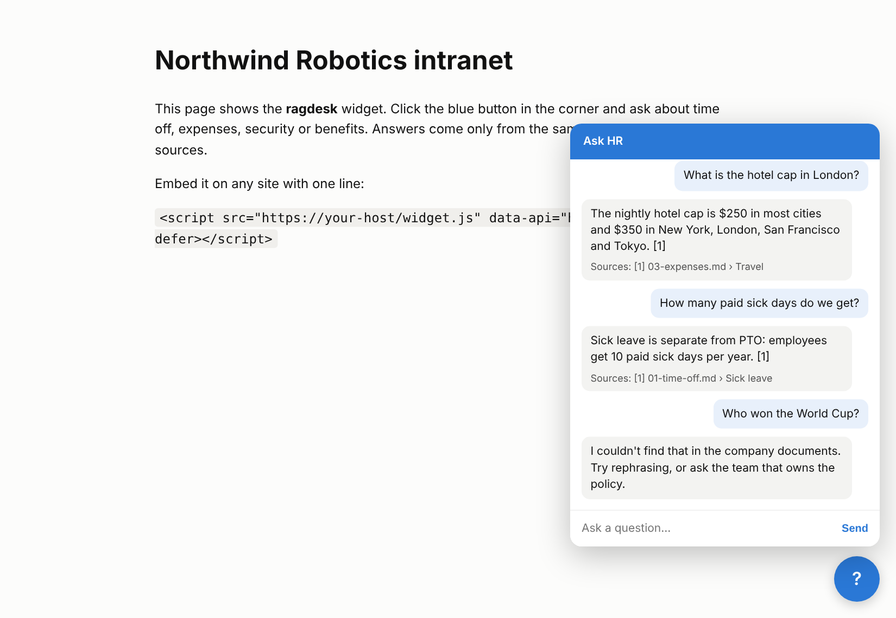
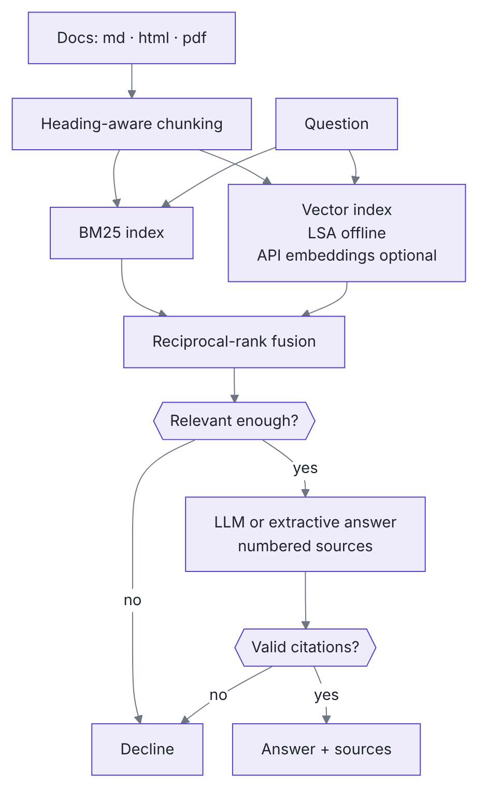

<div align="center">

<picture>
  <source media="(prefers-color-scheme: dark)" srcset="docs/img/logo-dark.svg">
  
</picture>

<p><em>Answers from your company's documents, with a citation for every sentence, and “I don't know” instead of a guess.</em></p>

[](https://github.com/faizanreza-cs/ragdesk/actions/workflows/ci.yml)


[](https://www.linkedin.com/in/YOUR-LINKEDIN-ID)
[](https://x.com/YOUR_X_HANDLE)

</div>

## ⚡ Overview

Point it at a folder of policies, handbooks or product docs (Markdown, HTML, PDF). Employees
or customers ask questions on your website, in Slack or over the API. Every answer cites the
section it came from.



## Features

| | |
|---|---|
| **Hybrid retrieval** | BM25 keyword search plus vector search, merged with reciprocal-rank fusion. Exact terms ("401(k)", "P1") and paraphrases both find the right section |
| **Cited answers** | Every sentence carries a `[n]` citation that maps to a document and section |
| **Refuses to guess** | Two guardrails: it declines when retrieval finds nothing relevant, and when the model's answer has no valid citation |
| **Evaluated** | A golden question set measures retrieval hit rate, MRR, answer accuracy, citation precision, and whether it correctly declines unanswerable questions |
| **Runs offline** | With no API key it answers extractively (verbatim sentences plus citations). Add a key for fluent LLM answers |
| **Ships anywhere** | REST API, one-line website widget, Slack bot (Socket Mode), CLI, Docker |

## How it works

<p align="center">
<picture>
  <source media="(prefers-color-scheme: dark)" srcset="docs/img/pipeline-dark.png">
  
</picture>
</p>

## Quickstart

```bash
git clone https://github.com/faizanreza-cs/ragdesk && cd ragdesk
make setup
make index                                   # indexes samples/handbook (a fictional company)
ragdesk ask "What is the hotel cap in London?"
make api                                     # API + widget demo at http://localhost:8000
```

Use your own documents and an LLM:

```bash
export RAGDESK_DOCS=/path/to/your/docs
export ANTHROPIC_API_KEY=...  RAGDESK_MODEL=<anthropic model id>
make index && make api
```

Embed the widget on any page:

```html
<script src="https://your-ragdesk-host/widget.js"
        data-api="https://your-ragdesk-host" data-title="Ask HR" defer></script>
```

For a public embed, set `RAGDESK_CORS_ORIGINS` to your site and put per-IP rate limiting in
front of `/ask` at your reverse proxy (for example nginx `limit_req`), since each question can
call a paid LLM.

Slack: `pip install 'ragdesk[slack]'`, set `SLACK_BOT_TOKEN` and `SLACK_APP_TOKEN`, then run
`make slack`. Mention the bot in a channel or DM it.

| Setting | Default | Meaning |
|---|---|---|
| `RAGDESK_DOCS` | `samples/handbook` | folder to index |
| `RAGDESK_PROVIDER` | `auto` | `anthropic`, `openai`, `extractive`; `auto` uses the LLM when a key and model are set |
| `RAGDESK_MODEL` | none | LLM model id |
| `RAGDESK_EMBEDDINGS` | LSA | `openai` to use API embeddings |
| `RAGDESK_TOP_K` | `5` | chunks passed to the generator |
| `RAGDESK_CORS_ORIGINS` | `*` | comma-separated sites allowed to call the API (set this for public embeds) |
| `RAGDESK_ADMIN_TOKEN` | none | enables `POST /reindex`; send it as the `X-Admin-Token` header |

## Evaluation

`make eval` runs 24 questions on the sample handbook: 20 answerable, plus 4 that it must
decline (stock ticker, World Cup, dress code, car lease).

Offline extractive baseline (no LLM):

| Metric | Score |
|---|---|
| Retrieval hit@5 | 95% |
| MRR | 0.95 |
| Answer accuracy (answerable) | 95% |
| Citation precision | 95% |
| Correct declines (unanswerable) | 75% |
| False declines | 0 |

The misses show where an LLM helps:

- **"When is payday?"** The docs say "paid monthly on the last working day". Keyword and
  LSA retrieval miss the paraphrase. Fix: API embeddings or query rewriting.
- **"What is the dress code?"** The extractive answerer latches onto "code of conduct". An
  LLM generator replies NOT_FOUND here, and the citation guardrail declines.

Run `make eval-llm` to measure the LLM generator on the same set.

## Engineering

- 16 tests: chunking, HTML cleaning, tokenisation, hybrid ranking, citation guardrails
  (an answer with any citation to a source it wasn't given is declined), refusal, index
  round-trip, messy folders (non-UTF-8 files, same file name in two folders, giant PDF
  paragraphs), Slack escaping, API auth, and eval thresholds.
- The index is written atomically, so a crash mid-write never leaves a broken index.

## License

MIT
